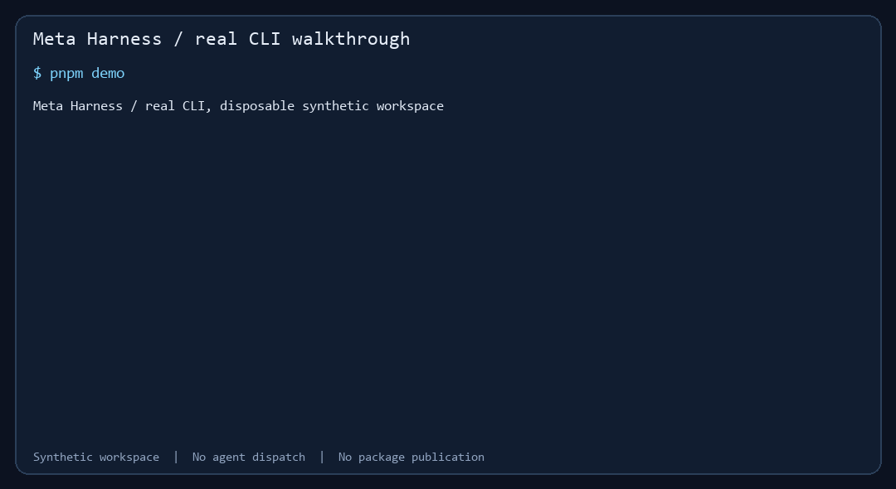

# Meta Harness

[](https://github.com/smgpulse007/meta-harness/actions/workflows/ci.yml)
[](https://github.com/smgpulse007/meta-harness/actions/workflows/schema-check.yml)
[](https://github.com/smgpulse007/meta-harness/actions/workflows/integration-smoke.yml)
[](https://github.com/smgpulse007/meta-harness/actions/workflows/package-dry-run.yml)
[](https://github.com/smgpulse007/meta-harness/actions/workflows/dependency-audit.yml)
[](https://github.com/smgpulse007/meta-harness/actions/workflows/codeql.yml)
[](LICENSE)
[](.node-version)
[](package.json)

Meta Harness turns large coding-agent implementation specs into evidence-gated phases, slices, packets, checkpoints, and continuation state.

It is not an LLM or a coding agent. It is the protocol, state machine, CLI, MCP server, adapter layer, templates, and skill package that coordinate coding agents around one rule:

> No phase advances without verified evidence.



Run `pnpm demo` to reproduce this recording. It uses the real CLI with a synthetic spec; no coding agent is dispatched. [Recording evidence](docs/demo-recording.json).

[Docs site](https://smgpulse007.github.io/meta-harness/) | [Getting started](docs/getting-started.md) | [Protocol](docs/protocol.md) | [Agent support](docs/agent-support-matrix.md) | [Security](SECURITY.md) | [Contributing](CONTRIBUTING.md) | [Release plan](docs/release-plan.md)

## Install From Source

Meta Harness is pre-1.0. The source checkout is the supported onboarding path until a maintainer-approved package release.
The monorepo root is private; publishable artifacts live in the scoped `@meta-harness/*` packages.

Requirements:

- Node.js 22 or newer
- pnpm 11.7.0

```bash
git clone https://github.com/smgpulse007/meta-harness.git
cd meta-harness
corepack enable
pnpm install --frozen-lockfile
pnpm run ci
```

Run the local CLI:

```bash
node packages/cli/dist/index.js --help
```

Try the real CLI in a disposable synthetic workspace:

```bash
pnpm demo
```

For the full walkthrough, see [Getting started](docs/getting-started.md).

## What It Does

- Converts implementation specs into phases, dependency-ordered slices, and packets.
- Enforces bounded write scopes, validation gates, proof ledgers, side-effect policy, and checkpoint artifacts.
- Emits instruction files for mainstream coding-agent environments.
- Provides a read-only-first MCP server for structured orchestration.
- Supports a universal filesystem protocol when native automation is unavailable.

## What It Does Not Do

- It does not implement a new LLM or coding agent.
- It does not guarantee correctness, safety, or full autonomy.
- It does not publish packages, push Git refs, mutate production systems, send email, rotate secrets, or perform financial transactions by default.
- It does not claim all adapters have the same level of support.

## Safety Defaults

- External systems are read-only by default.
- MCP starts in `read-only` mode.
- Write tools require explicit `checkpoint-write` or `workspace-write` mode.
- Package publishing, Git pushes, releases, production writes, email, financial transactions, and infrastructure changes require explicit maintainer approval.
- Fake adapter output is simulation evidence only and cannot satisfy production implementation proof.

## Integration Tiers

- Tier 0: filesystem protocol. Works with any coding agent by writing prompt and packet files.
- Tier 1: generated instruction files for tools such as Codex, Claude, Gemini, Cursor, Windsurf, Copilot, Continue, OpenCode, and Roo.
- Tier 2: CLI adapter dispatch where a tool is detected and a safe prompt-file flow is configured.
- Tier 3: MCP integration and planned native dispatch where the host supports structured tool calls. Native dispatch remains experimental unless explicitly marked verified in the [support matrix](docs/agent-support-matrix.md).

## Quickstart

The recorded walkthrough builds the CLI, initializes a fresh temporary workspace, verifies its generated read-only policy, and compiles and checks a synthetic plan. It removes only its own temporary directory afterward. No external coding agent is launched and no completed implementation is claimed:

```bash
pnpm install --frozen-lockfile
pnpm demo
```

For your own project, follow [Getting started](docs/getting-started.md) to initialize a separate target directory. Do not run `init --force` in this source checkout to try the example: that would overwrite its tracked harness state. There is one default read-only policy; the former no-op `--profile` option is no longer accepted.

## CLI

The CLI binary is `mh`.

Implemented commands:

- `mh init`
- `mh ingest`
- `mh compile-spec`
- `mh plan`
- `mh lint-plan`
- `mh dispatch`
- `mh collect`
- `mh verify`
- `mh audit-checkpoint`
- `mh checkpoint`
- `mh continue`
- `mh budget`
- `mh context-pack`
- `mh prompt`
- `mh summarize-log`
- `mh emit-instructions`
- `mh doctor`
- `mh mcp --stdio`

## MCP Server

Start the server over stdio:

```bash
node packages/cli/dist/index.js mcp --stdio
```

Default mode is `read-only`. Write tools require `--mode checkpoint-write` or `--mode workspace-write`. Dangerous operations are not exposed by default.

## Skill Usage

The reusable skill lives in `skills/meta-harness/SKILL.md`. Host-specific copies are available at `.agents/skills/meta-harness/SKILL.md` and `.claude/skills/meta-harness/SKILL.md`. They tell a compatible agent how to ingest a spec, build a manifest, plan slices, validate packets, write checkpoints, produce proof, and stop or continue according to `next_action.yaml`.

## Instruction Emitters

Generate agent instructions:

```bash
node packages/cli/dist/index.js emit-instructions --target all
```

Generated targets include `AGENTS.md`, `CLAUDE.md`, `GEMINI.md`, Cursor rules, Windsurf rules, Copilot repository and path-specific instructions, Continue rules, OpenCode instructions/config, and Roo rules/MCP config. They are derived from the canonical protocol text.

## Context Packs

Generate a bounded target-specific prompt pack from local harness state:

```bash
node packages/cli/dist/index.js context-pack --target codex --phase phase_001 --budget 8000 --format markdown
```

Check repository instruction, skill, MCP description, context-pack, and evidence-excerpt budgets:

```bash
node packages/cli/dist/index.js budget --json
```

Convert raw command output into a bounded, redacted evidence excerpt:

```bash
node packages/cli/dist/index.js summarize-log --input docs/examples/evidence-excerpts/sample-command-output.txt --command "pnpm test" --exit-code 0 --format json
```

`mh prompt` is an alias for the same pack generator.

## Example Workflow

See `examples/tiny-typescript-refactor` for a fake-adapter end-to-end flow that produces a slice plan, packet, checkpoint, proof ledger, and next action without an external coding agent.

## Support Matrix

See `docs/agent-support-matrix.md`. Adapter support is best-effort and adapter-specific. Filesystem prompt packets are the reliable fallback.

## Security Model

See `docs/threat-model.md`. The core posture is read-only unless explicitly configured otherwise. Path traversal is blocked, secret-like values are redacted, and MCP does not execute arbitrary shell commands.

## Continuation Source of Truth

`next_action.yaml` is the machine-readable continuation contract. `next_prompt.md` may be useful for humans, but runners and parent agents must use `next_action.yaml`.

## Roadmap

Release readiness is verified with `pnpm run release:dry-run` or the manual `Release Dry Run` workflow. See `docs/release-plan.md`.
